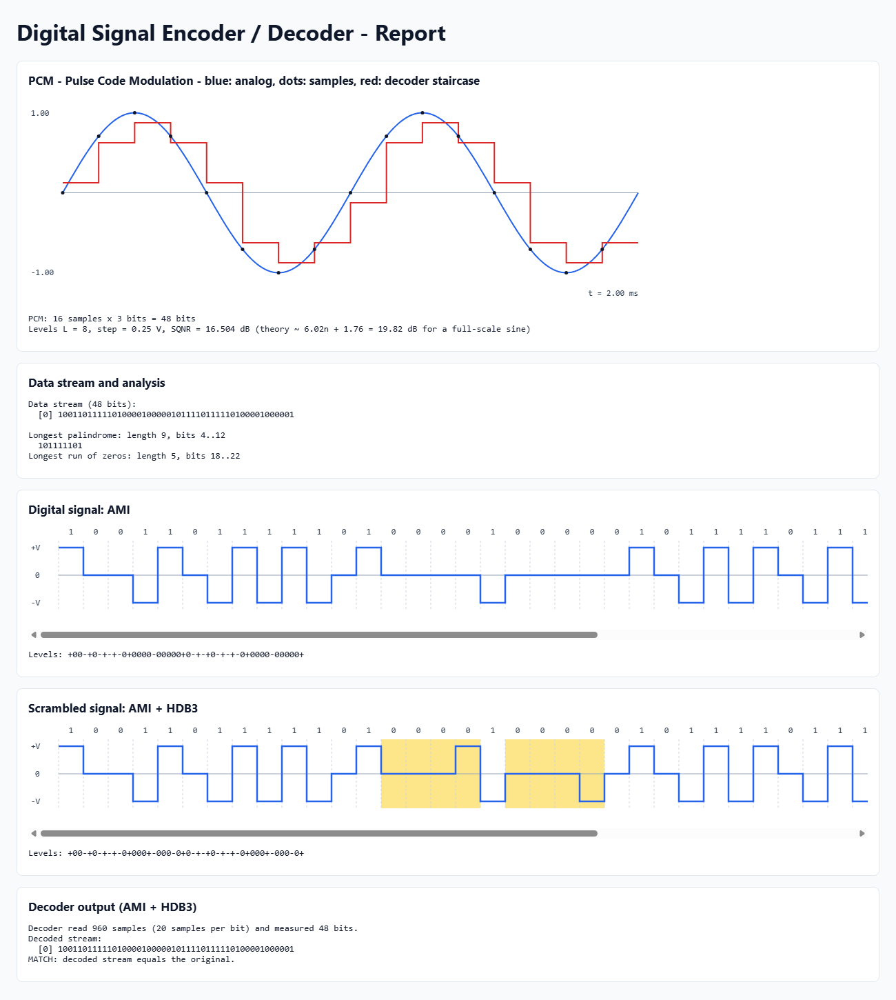

# Digital Signal Encoder and Decoder (C++17)

A terminal program that generates digital data, line-codes it, scrambles it, converts analog signals with PCM / DM, and decodes the signal back **from its waveform**, not from the bit values.

Only the C++ standard library is used. Plots are drawn as ASCII in the terminal and as SVG in an HTML report.



## Features

| Part | What it does |
|---|---|
| Data generator | Typed bits, completely random bits, or random bits with fixed runs of 4 or 8 zeros |
| Stream analysis | Longest palindrome (Manacher's algorithm, O(n)) and longest run of zeros (O(n)) |
| Line coding | NRZ-L, NRZ-I, Manchester, Differential Manchester, AMI |
| Scrambling | B8ZS and HDB3 (offered when AMI is chosen) |
| Analog input | Sine, two-tone or triangle signal → PCM or DM → staircase from the decoder → line coding |
| Decoder | Reads the saved waveform `output/signal.csv`, measures voltage levels, and rebuilds the bits |
| Output | ASCII waveforms in the terminal and `output/report.html` with SVG plots |
| Self-test | `--test` checks every encoder/decoder pair and the algorithms (3011 checks) |

## Build and run

Any C++17 compiler works (tested with GCC 16.1, MSYS2 UCRT64, on Windows 11).

```bash
g++ -std=c++17 -O2 -Wall -Wextra -static -o encoder src/main.cpp
./encoder          # interactive menu
./encoder --test   # automatic self-test
```

`-static` lets the Windows `.exe` run without the MinGW runtime DLLs. On Linux or macOS you can drop it.

Program flow: choose **digital** or **analog** input → choose a line code → for AMI, choose whether to scramble and with B8ZS or HDB3 → see the plots → choose whether to decode. Press Enter to accept the default shown in `[brackets]`.

## Project layout

```
src/
  data_generator.hpp   random streams, Manacher palindrome, longest zero run
  line_coding.hpp      LineCoder classes, waveform synthesis, CSV save/load, level measurement
  modulation.hpp       sampling, PCM and DM encoders/decoders, SQNR, slope check
  plot.hpp             ASCII plots, SVG plots, HTML report
  main.cpp             menus, input checks, self-test
report/
  specification.pdf    one-page specification report
```

## Design notes

- **No long if/else or switch chains.** Each scheme is a subclass of the abstract class `LineCoder`, with virtual `encode` and `decode` functions. Menus are tables of (label, function) pairs.
- **Decoding from the signal.** The transmitted waveform (20 samples per bit, V = 1 V) goes into a CSV file. The decoder reads only that file. It gets the samples-per-bit value from the time axis, samples each bit at ¼ and ¾ of its length, and uses thresholds at ±V/2. Then it applies the scheme's rule: a level, a transition, or a bipolar violation.
- **Linear-time scrambling.** One right-to-left pass builds `zerosFrom[i]`, the number of zeros that start at position `i`. This makes each B8ZS / HDB3 substitution check O(1).

## Conventions

The conventions follow Forouzan, *Data Communications and Networking*:

- NRZ-L: 0 → +V, 1 → −V. NRZ-I: a 1 inverts the level, and the line starts at +V.
- Manchester: 0 = high→low, 1 = low→high (IEEE 802.3). Differential Manchester: always a transition in the middle of the bit, and a 0 adds one at the start.
- AMI: the first 1 is +V. B8ZS: `00000000 → 000VB0VB`. HDB3: `0000 → 000V` if the number of pulses since the last substitution is odd, otherwise `B00V`.
- PCM: uniform mid-rise quantizer over [−A, A], MSB first. DM: the staircase starts at 0.
